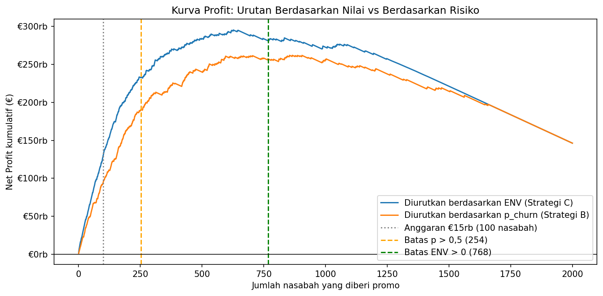
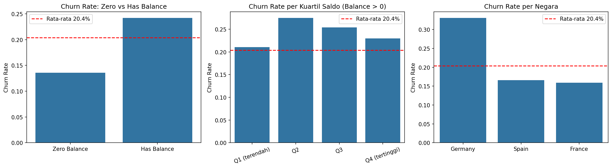
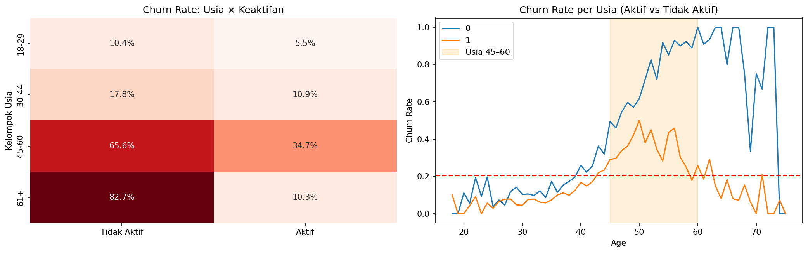
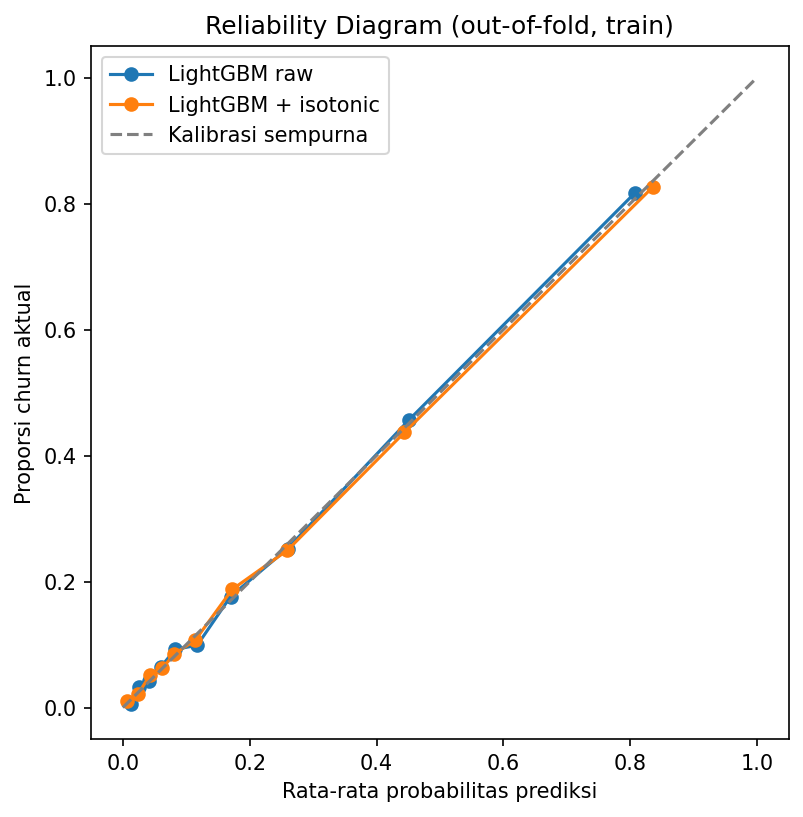
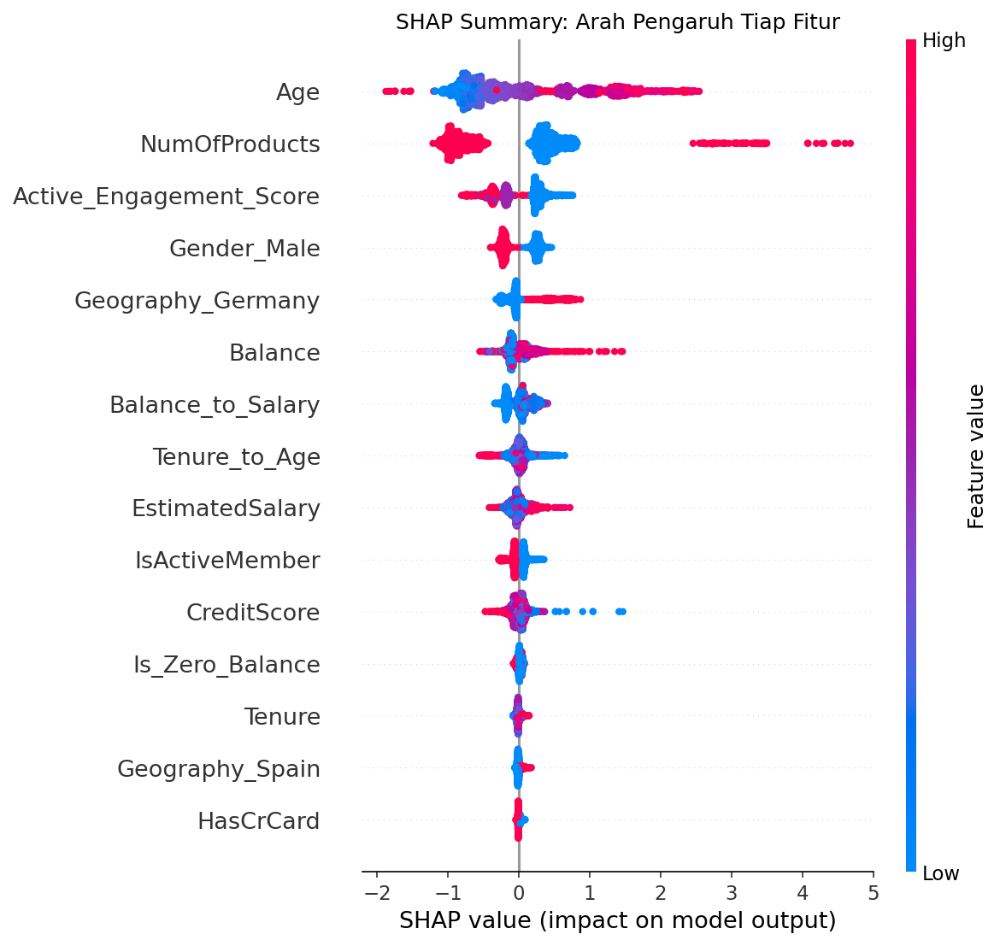
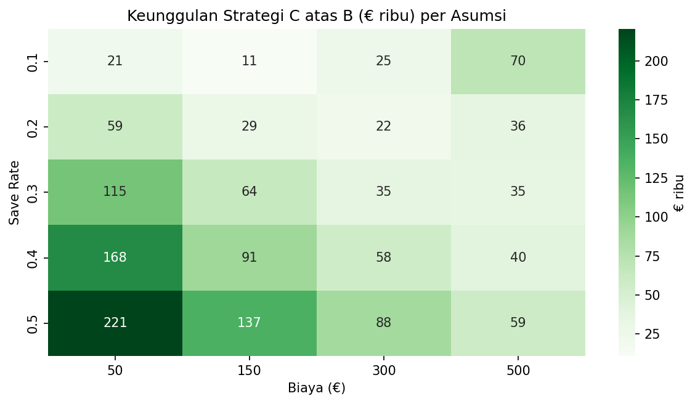

# Profit-Driven Bank Customer Churn Prediction & CASA Retention Optimization

Model prediksi churn nasabah bank yang tidak berhenti di pertanyaan *"siapa yang akan pergi?"*, tetapi menjawab pertanyaan bisnis: **"siapa yang menguntungkan untuk dipertahankan?"**



## Ringkasan

| | |
|---|---|
| **Masalah** | Promo retensi yang disebar berdasarkan threshold probabilitas 0,50 membuang anggaran ke nasabah bernilai rendah, termasuk rekening bersaldo nol |
| **Pendekatan** | LightGBM terkalibrasi + *Expected Net Value* (ENV) per nasabah berbasis margin bunga saldo |
| **Performa model (test)** | PR-AUC 0,725 · ROC-AUC 0,871 · Brier Score 0,098 |
| **Dampak bisnis** | Net Retention Profit **€280.918** vs €190.403 pada strategi threshold 0,50 (**+47,5%**) |
| **Pada anggaran sama (€15.000)** | €129.858 vs €94.556 (**+37,3%**) |
| **Robustness** | Strategi berbasis ENV unggul di **20 dari 20** skenario asumsi biaya dan *save rate*, dan tidak pernah rugi |

---

## 1. Latar Belakang

Kehilangan nasabah (*customer attrition*) menggerus Dana Pihak Ketiga (DPK/CASA) dan pendapatan bank. Cara umum untuk menahannya adalah insentif retensi, misalnya cashback atau pembebasan biaya administrasi. Namun, insentif yang diberikan merata kepada semua nasabah berisiko tinggi tidak efisien: sebagian anggaran jatuh ke nasabah yang kontribusi pendapatannya minimal.

**Tujuan:** membangun model probabilitas churn yang terkalibrasi, lalu menggabungkannya dengan nilai ekonomi tiap nasabah untuk memilih target retensi yang menghasilkan *Net Retention Profit* positif.

## 2. Dataset

[Bank Customer Churn Modelling](https://raw.githubusercontent.com/sharmaroshan/Churn-Modelling-Dataset/master/Churn_Modelling.csv): 10.000 nasabah bank di Prancis, Jerman, dan Spanyol, dengan 14 kolom (demografi, saldo, jumlah produk, status keaktifan, dan label `Exited`).

- Churn rate: **20,37%**
- Rekening bersaldo nol: **36,17%**
- Tidak ada *missing value* maupun duplikat `CustomerId`

## 3. Alur Kerja

```
Data Cleaning & Stratified Split (80/20)
        ↓
EDA: uji 3 hipotesis bisnis (train set)
        ↓
Feature Engineering: 4 fitur perilaku finansial
        ↓
Modeling: LogReg vs Random Forest vs LightGBM (5-fold Stratified CV)
        ↓
Probability Calibration: isotonic vs sigmoid vs raw
        ↓
Evaluasi final di test set 
        ↓
SHAP: interpretasi global & lokal
        ↓
Simulasi profit 3 strategi + analisis sensitivitas + daftar nasabah prioritas
```

Prinsip yang dijaga: seluruh EDA, encoding, scaling, tuning, dan pemilihan model hanya memakai train set. Test set dipakai sekali di akhir untuk evaluasi dan simulasi bisnis.

## 4. Temuan EDA

**H1. Zero-Balance vs High-Balance: ditolak sebagian**
Secara agregat, nasabah bersaldo justru churn lebih tinggi (24,2%) dibanding rekening bersaldo nol (13,6%). Sebagian selisih ini didorong oleh Jerman, yang seluruh nasabahnya bersaldo dan memiliki churn 33,1%. Setelah dikontrol per negara, efeknya tetap ada tetapi lebih kecil: sekitar 5 poin persen di Prancis (18,1% vs 13,5%) dan Spanyol (19,2% vs 13,7%). Artinya, yang bocor adalah nasabah penyimpan dana, yaitu sumber CASA.



**H2. Paradoks jumlah produk: terbukti**
Pola berbentuk U. Nasabah dengan 2 produk paling loyal (churn 7,4%), sedangkan 3 produk churn 82,1% dan 4 produk 100%. Interval kepercayaan 95% tidak beririsan, sehingga perbedaannya bukan kebetulan. Ini indikasi *over-selling*. Catatan: segmen 3+ produk hanya 3,2% nasabah.


**H3. Usia × keaktifan: terbukti**
Efek ketidakaktifan membesar seiring usia: selisih churn tidak aktif vs aktif hanya 4,9 poin persen di usia 18–29, tetapi 30,9 poin di usia 45–60 dan 72,3 poin di usia 61+. Usia 45–60 menyumbang sekitar 45% dari seluruh churn, padahal hanya 18,6% dari nasabah. Nasabah senior yang tetap aktif justru sangat loyal.



## 5. Feature Engineering

| Fitur | Rumus | Makna bisnis |
|---|---|---|
| `Balance_to_Salary` | Balance / (EstimatedSalary + 1) | *Share of wallet*: porsi penghasilan yang diendapkan di bank |
| `Is_Zero_Balance` | 1 jika Balance = 0 | Rekening transit vs penyimpan dana |
| `Tenure_to_Age` | Tenure / Age | Kedalaman hubungan relatif terhadap usia |
| `Active_Engagement_Score` | NumOfProducts × IsActiveMember | Banyak produk dan aktif vs banyak produk tapi dorman |

`Active_Engagement_Score` memberi sinyal kuat. `Balance_to_Salary` hampir tidak berpengaruh karena `EstimatedSalary` di dataset ini terdistribusi seragam.

## 6. Modeling

Perbandingan dengan 5-fold Stratified Cross-Validation di train set:

| Model | PR-AUC | ROC-AUC | Brier Score |
|---|---|---|---|
| **LightGBM (tuned)** | **0,704** | **0,866** | **0,101** |
| Random Forest | 0,685 | 0,859 | 0,105 |
| Logistic Regression | 0,477 | 0,764 | 0,136 |
| Logistic Regression (`class_weight='balanced'`) | 0,466 | 0,766 | 0,196 |
| *Acuan: tebakan tanpa model* | *0,204* | *0,500* | *0,162* |

Temuan utama:
- Lompatan besar dari model linear ke model pohon mengonfirmasi pola non-linear dari EDA.
- `class_weight='balanced'` tidak meningkatkan kemampuan ranking, tetapi merusak kalibrasi: Brier Score-nya lebih buruk daripada tebakan tanpa model. Probabilitas seperti ini berbahaya jika dikalikan dengan nilai uang.
- LightGBM di-*tune* dengan `RandomizedSearchCV` (40 kombinasi, metrik PR-AUC).

### Kalibrasi Probabilitas

Isotonic dan sigmoid calibration diuji melalui nested CV. Keduanya tidak memperbaiki Brier Score (0,1014 → 0,1017 dan 0,1026), karena LightGBM tanpa pembobotan kelas sudah terkalibrasi baik. Model raw dipilih atas dasar parsimoni.



### Evaluasi Test Set

| Metrik | CV (train) | Test |
|---|---|---|
| PR-AUC | 0,704 | **0,725** |
| ROC-AUC | 0,866 | **0,871** |
| Brier Score | 0,101 | **0,098** |
| Rata-rata probabilitas vs churn aktual | — | 0,2041 vs 0,2035 |


## 7. Interpretasi Model (SHAP)

Pendorong utama churn: **usia**, **jumlah produk**, **keterikatan aktif**, **jenis kelamin** (perempuan lebih berisiko), dan **Jerman**. Urutan dan arahnya konsisten dengan EDA.



**Contoh lokal: risiko sama, keputusan berlawanan**

| | Nasabah 15679249 | Nasabah 15707637 |
|---|---|---|
| Profil | Perempuan, 57 tahun, tidak aktif, 1 produk | Perempuan, 56 tahun, tidak aktif, 1 produk |
| Negara | Jerman | Prancis |
| Saldo | €163.146 | €0 |
| Probabilitas churn | 0,958 | 0,959 |
| Pendapatan tahunan | €4.944 | €50 |
| **Expected Net Value** | **+€1.746 → beri promo** | **−€131 → tidak diberi promo** |

| High-Balance | Zero-Balance |
|---|---|
|  |  |

## 8. Dampak Bisnis

### Asumsi keuangan

| Parameter | Nilai |
|---|---|
| Pendapatan tahunan per nasabah | Balance × 3% (NIM) + €50 jika memiliki kartu kredit |
| Biaya retensi | €150 per nasabah yang ditargetkan |
| *Save rate* | 40% dari nasabah churn yang diberi promo |

### Expected Net Value

Biaya promo selalu keluar, sedangkan pendapatan hanya terselamatkan jika nasabah memang akan churn **dan** berhasil ditahan:

$$\text{ENV}_i = \hat{p}_i \times \text{Save Rate} \times \text{Revenue}_i - \text{Cost}$$

> **Catatan:** rumus pada brief awal, $\hat{p}_i \cdot s \cdot (\text{Rev}_i - C) - (1-\hat{p}_i) \cdot C$, tidak memperhitungkan biaya promo untuk nasabah churn yang gagal ditahan. Rumus di atas adalah versi koreksinya. Dalam praktik, keputusan keduanya hampir sama (768 vs 793 target), karena pendapatan nasabah bersaldo jauh di atas biaya promo.

Konsekuensi langsung: nasabah bersaldo nol (pendapatan maksimal €50) tidak pernah layak diberi promo, karena 0,4 × €50 = €20 < €150.

### Hasil pada 2.000 nasabah test

ENV dipakai untuk **memutuskan** target (sebelum hasil diketahui). Label churn aktual dipakai untuk **menilai** hasilnya.

| Strategi | Ditarget | Saldo nol ditarget | Churner tertangkap | Biaya promo | Pendapatan terselamatkan | **Net Profit** |
|---|---|---|---|---|---|---|
| A. Tanpa intervensi | 0 | 0 | 0 | €0 | €0 | **€0** |
| B. Threshold p > 0,50 | 254 | 59 | 202 | €38.100 | €228.503 | **€190.403** |
| **C. ENV > 0** | 768 | 0 | 263 | €115.200 | €396.118 | **€280.918** |
| B-budget. Top 100 probabilitas | 100 | 22 | 94 | €15.000 | €109.556 | **€94.556** |
| **C-budget. Top 100 ENV** | 100 | 0 | 86 | €15.000 | €144.858 | **€129.858** |

- Tanpa intervensi, bank kehilangan **€1.115.750** pendapatan tahunan. Batas maksimal yang bisa diselamatkan (save rate 40%) adalah €446.300. Strategi C menyelamatkan **€396.118 (88,8%)** dari batas tersebut.
- **Pada anggaran yang sama, C-budget menangkap churner lebih sedikit (86 vs 94), tetapi profitnya 37,3% lebih tinggi.** Menyelamatkan churner yang tepat lebih penting daripada menyelamatkan churner yang banyak.
- Strategi B menghabiskan 23% promonya (59 dari 254) untuk rekening bersaldo nol.
- Total ENV yang diharapkan model (€295.034) hanya berselisih 4,8% dari profit aktual (€280.918). Ini validasi kalibrasi dalam satuan uang.

### Analisis sensitivitas

Save rate dan biaya promo adalah asumsi, sehingga diuji pada 20 kombinasi (save rate 10–50%, biaya €50–500).



- Strategi C unggul atas B di **20 dari 20 skenario** (keunggulan €10.877 hingga €220.557).
- Strategi B **rugi di 3 skenario pesimis**, hingga −€69.874.
- Strategi C **tidak pernah rugi**. Pada skenario terburuk (save rate 10%, biaya €500), jumlah target menyusut otomatis menjadi 3 nasabah dan tetap untung.

### Output operasional

`outputs/priority_list.csv` berisi 768 nasabah dengan ENV > 0, diurutkan berdasarkan ENV, beserta penanda 100 nasabah teratas yang masuk anggaran €15.000. Kolom label churn sengaja tidak disertakan untuk mensimulasikan daftar yang benar-benar dikirim ke tim bisnis sebelum hasil diketahui.

## 9. Rekomendasi Bisnis

1. **Ganti threshold probabilitas dengan aturan berbasis nilai (ENV > 0).** Jika anggaran terbatas, urutkan berdasarkan ENV, bukan probabilitas churn.
2. **Prioritaskan nasabah bersaldo di Jerman dan usia 45–60 yang tidak aktif.** Segmen ini menyumbang porsi terbesar churn bernilai tinggi.
3. **Program re-aktivasi transaksi untuk nasabah 45+ yang dorman.** Nasabah senior yang aktif terbukti sangat loyal.
4. **Evaluasi kebijakan cross-selling setelah produk kedua.** Untuk segmen 3+ produk, *review* portofolio produk kemungkinan lebih efektif daripada cashback.

## 10. Keterbatasan & Pengembangan

- **Pendapatan hanya diproksikan dari margin bunga saldo (NIM) dan fee kartu kredit**, karena dataset tidak memiliki data transaksi. Di bank ritel nyata, rekening bersaldo rendah sering kali milik nasabah transaksional aktif (payroll, transfer, QRIS, pembayaran tagihan) yang menghasilkan *fee-based income* signifikan. Kesimpulan bahwa rekening bersaldo nol tidak layak diberi promo berlaku dalam kerangka NIM saja. **Pengembangan:** mengintegrasikan fee-based income dari data mutasi ke dalam `Revenue`.
- **Save rate 40% diasumsikan seragam.** Dalam praktik, efektivitas promo berbeda antarsegmen (misalnya segmen *over-selling*). **Pengembangan:** A/B test kampanye atau *uplift modeling* untuk mengestimasi efek promo per nasabah.
- **Horizon satu tahun:** nilai seumur hidup nasabah (*customer lifetime value*) belum diperhitungkan.
- Puncak kurva profit aktual (627 nasabah) berbeda dari batas ENV > 0 (768). Selisih ini hanya bisa diketahui setelah hasil terlihat, sehingga cutoff tidak disesuaikan berdasarkan test set.

## 11. Struktur Repository

```
├── README.md
├── requirements.txt
├── notebooks/
│   └── profit_driven_bank_customer_churn.ipynb
├── images/          # grafik yang dipakai di README
└── outputs/
    ├── test_predictions.csv   # probabilitas churn untuk test set
    └── priority_list.csv      # daftar nasabah prioritas retensi
```

## 12. Cara Menjalankan

**Google Colab (disarankan):** buka `notebooks/profit_driven_bank_customer_churn.ipynb` di Colab, lalu pilih *Runtime → Run all*. Dataset diunduh otomatis dari URL.

**Lokal:**
```bash
git clone https://github.com/MinhajulKhairi/bank-churn-casa-retention.git
cd bank-churn-casa-retention
pip install -r requirements.txt
jupyter notebook notebooks/profit_driven_bank_customer_churn.ipynb
```

Seluruh proses memakai `random_state=42`, sehingga hasil dapat direproduksi.

**Tools:** Python · pandas · scikit-learn · LightGBM · SHAP · statsmodels · matplotlib · seaborn

---

## Kontak

**Minhajul Yusri Khairi** · [LinkedIn](https://www.linkedin.com/in/minhajulkhairi/) · [Email](minhajulkhairi@gmail.com)
